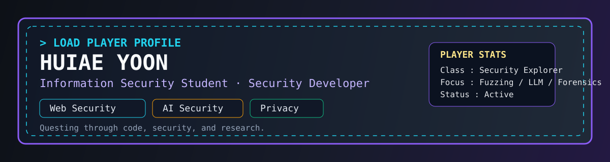

<div align="center">



# 🎮 PLAYER PROFILE — HUIAE YOON

```txt
> STATUS : ACTIVE
> CLASS  : Information Security Student / Security Developer
> REGION : Seoul Women's University
> BUILD  : Web Security · AI Security · Privacy · Digital Forensics
```

[](https://github.com/yooniia)
[](https://yooniia.tistory.com)
[](#)

</div>

---

## 🕹️ START MENU

안녕하세요! 저는 **정보보호와 개발을 연결하는 윤희애(Huiae Yoon)**입니다.

취약점을 단순히 발견하는 것에 그치지 않고, **원인을 분석하고 자동화로 해결하는 과정**을 좋아합니다.  
현재는 **웹 보안, AI 보안, 개인정보보호, 디지털 포렌식**을 중심으로 경험을 쌓고 있으며,
직접 만들고 실험하면서 성장하는 개발자를 목표로 하고 있습니다.

```txt
[PLAYER INFO]
Name        : Huiae Yoon
Guild        : Dept. of Information Security, Seoul Women's University
Level Plan   : 2022.03 입학 ~ 2027.02 졸업 예정
Main Traits  : Curiosity / Responsibility / Continuous Learning
Current Quest: Agent-based Fuzzing · LLM Security Research · ML-KEM Study
```

---

## ⚔️ SKILL TREE

### Language Weapons


### Security Equipment


### Passive Skills / Research Tags
`Web Security` `Vulnerability Analysis` `Fuzzing` `LLM` `Fine-Tuning` `Prompt Engineering` `RAG` `Privacy` `K-Anonymity` `L-Diversity` `Digital Forensics`

---

## 📜 QUEST LOG

### Quest 01. LLM-based Web Application Fuzzer
**Difficulty:** ★★★★★  
**Period:** `2024.03 ~ Present`

> 웹 애플리케이션 취약점 탐지를 자동화하고,  
> LLM을 활용해 취약점 원인 분석과 수정 방향까지 제안하는 보안 시스템을 연구 중입니다.

**Mission Clear Log**
- 웹 애플리케이션 **취약점 자동 탐지 및 분석 시스템** 개발
- LLM 기반 **취약점 유형·원인 분석 및 코드 수정 방안 제안**
- **RAG 적용**을 통한 개인정보보호법 위반 가능성 검토
- **Agent 기반 Fuzzing**으로 연구 고도화 및 논문 작성 진행 중

**Reward Tags**  
`LLM` `Fuzzing` `Prompt Engineering` `RAG` `Security Automation`

---

### Quest 02. Cryptocurrency Exchange Database
**Difficulty:** ★★★★☆  
**Period:** `2024.03 ~ 2024.06`

> 가상화폐 거래소 환경을 가정하여,  
> 데이터베이스에 **암호화와 비식별화**를 적용한 보안 설계를 수행했습니다.

**Mission Clear Log**
- 주요 데이터 **암호화 적용**
- 고객 테이블 **마스킹 / 범주화 / 컬럼 삭제** 수행
- **K-익명성 / L-다양성** 기반 익명화 적용

**Reward Tags**  
`Database Security` `Privacy` `Encryption` `De-identification`

---

### Quest 03. AI Ethics Guideline Proposal
**Difficulty:** ★★★☆☆  
**Period:** `2024.09 ~ 2024.12`

> AI 자율형 살상무기의 개발과 사용 문제를 주제로,  
> 책임 있는 AI 활용을 위한 윤리 가이드라인을 제안했습니다.

**Mission Clear Log**
- AI 자율형 무기의 윤리적 문제 분석
- 온·오프라인 캠페인 및 포스트잇 토론 활동 진행
- AI 기술의 책임 있는 개발·사용을 위한 가이드라인 제시

**Reward Tags**  
`AI Ethics` `Research` `Responsible AI`

---

## 🏆 ACHIEVEMENTS UNLOCKED

| Year | Achievement |
| :--: | --- |
| **2024** | 🥇 2024 사이버시큐리티 해커톤 **최우수상** |
| **2024** | 👑 개인정보보호 PBL **대상** |
| **2024** | 🏅 일반 PBL **최우수상** |
| **2023** | 🏅 GURU 해커톤 Android 부문 **장려상** |
| **2022** | 🏅 GURU 해커톤 Python 부문 **우수상** |

---

## 🧩 SIDE QUESTS

<details>
<summary><b>Click to open side quests</b></summary>
<br>

### 🎓 Leadership
- **정보보호학과 학생회**: 행사 기획, 동문 카페 관리, 정학생회장 활동
- **미래산업융합대학 학생회 / 총학생회**: 예산 관리, 행사 총괄 기획 및 집행
- **학생대표자회의 및 중앙운영위원회 활동**

### 🌍 Volunteer
- **월드프렌즈코리아 ICT 봉사단**: 스리랑카 대상 HTML 교육
- **코드클럽 SW 교육기부단**: 초등학생 대상 스크래치 교육
- **네이버커넥트 1784 스쿨혁명**: 초등학생 AI 멘토링

### 🔐 Security Community
- **SWING 정보보호학과 학회** 활동
- 웹 해킹, 디지털 포렌식, 리버싱, 리눅스 등 스터디 수강
- 보안 카드뉴스 제작 및 기술 세미나 발표
- CTF 참여 및 보안 분야 탐구 활동 지속

</details>

---

## ❤️ PLAYER VALUES

```txt
Curiosity   → 새로운 기술을 직접 탐구하고 실험합니다.
Responsibility → 맡은 역할을 끝까지 책임 있게 수행합니다.
Growth      → 배운 내용을 정리하고, 더 나은 방식으로 확장합니다.
```

---

## 📡 CONTACT / PORTAL

<div align="center">

[](https://github.com/yooniia)
[](https://yooniia.tistory.com)

```txt
> SYSTEM MESSAGE:
> A security-minded player is still growing.
> New quests are always welcome.
```

</div>
